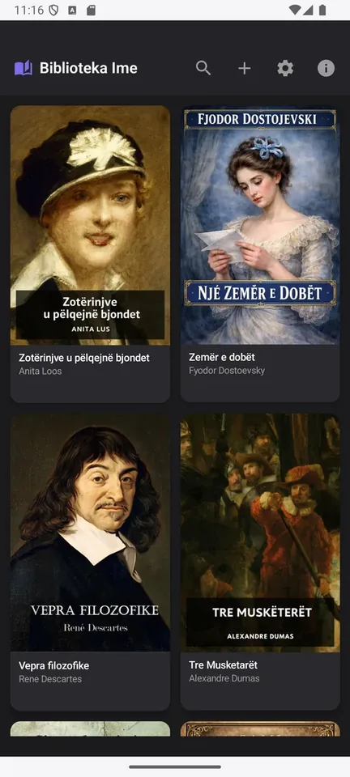
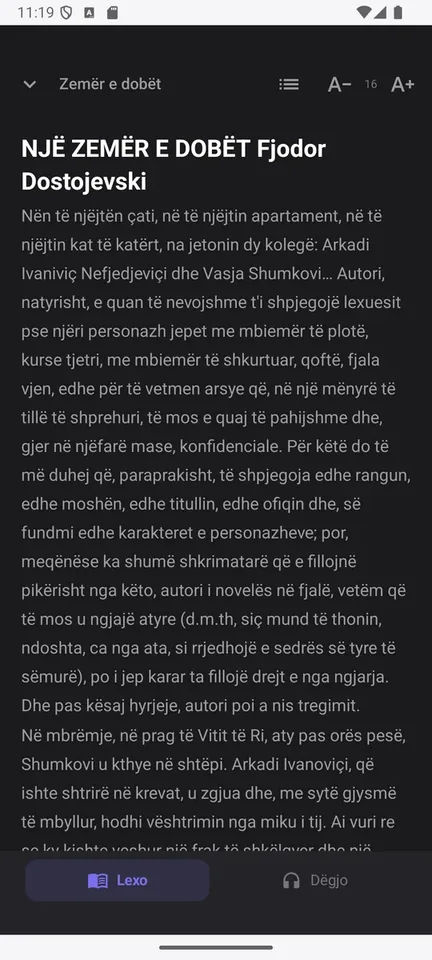
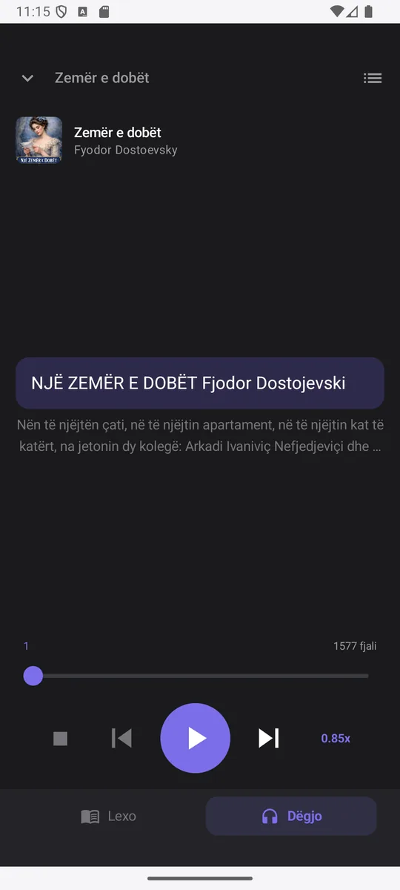
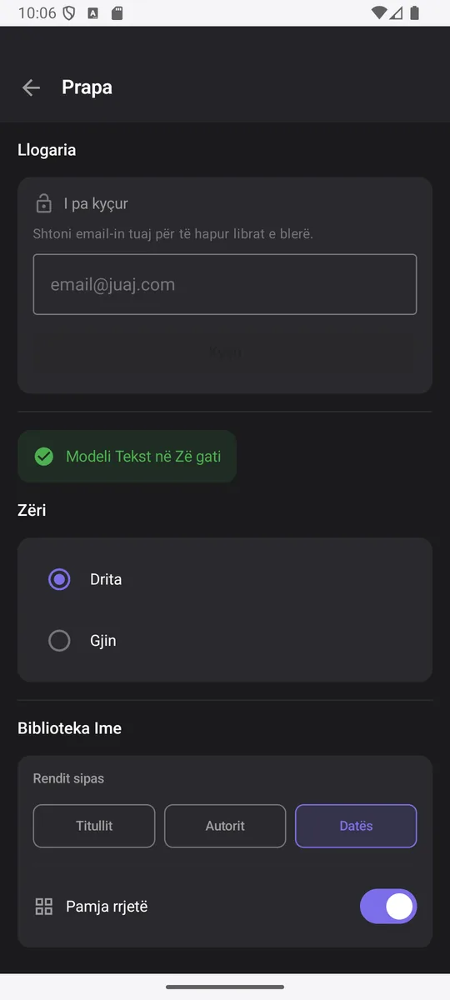

# LetraShqip on Android: A Library in Your Pocket

The LetraShqip Android app brings your entire digital library into your pocket: the books you bought, the books you imported yourself, and the books you already started reading — ready to open with a single tap.

The app is built for everyday use. Open a title, read a few pages and close it. When you come back, you find it where you left it, without having to keep track of where you stopped.

## What the app offers

### A library that stays with you

- Books you bought on letrashqip.com appear automatically once you sign in
- Import your own books from your own book files
- Search by title or author, and sort by title, author or date added

### Calm reading, even offline

**The reader: chapter text, table of contents and font size controls.**

- Text opens instantly and works fully offline
- Move between chapters with the table of contents
- Mathematical and scientific formulas written in LaTeX appear inside the text
- Book images (WebP, PNG, JPG, SVG) appear where they belong
- If you close the app mid-page, your position is saved

### Listen to books with Albanian voices

You can now listen to books in Albanian. The app uses two Albanian voices, **Drita** and **Gjin**, which work completely without an internet connection.

**Listening mode: play, pause, jump to the next sentence and control the speed.**

- Play, pause and resume from the sentence where you left off
- Adjust the speech speed

### Settings that fit you

In Settings you choose the account, the voice, the text-to-speech speed, the sorting order and the library layout. Preferences are stored on the device and wait for you the next time you open the app.

**Settings: account, voice, speech speed and library layout.**

## How to get started

1. Download the app from the [LetraShqip downloads page](https://letrashqip.com/download)
2. Open the app and go to Settings
3. Sign in with the email and password of your letrashqip.com account
4. Refresh the library so the books you bought download to the device
5. Open a title and read, or press "Play" to listen

Don't have an account yet? Signing up on letrashqip.com is free and your first book is a gift.

## Frequently asked questions

**Does it work offline?** Yes. Reading and listening happen on the device once the book has been downloaded. Internet is needed only to sign in and to download new books.

**Does the app open books bought on letrashqip.com?** Yes. Purchased books are protected with encryption and open only when you are signed in with the email they were bought with.

**Which devices does it work on?** Phones and tablets with Android 8.0 (Oreo) or newer. The interface is in Albanian and English and follows the language of the device.

**Does the app send my data to a server?** Apart from signing in and downloading purchased books, your library, your progress and your settings stay on your device.

## Start today

The app is part of the LetraShqip platform, where you find books translated into Albanian for reading and listening. Download the app, sign in and pick up the book you have been waiting for.

---
