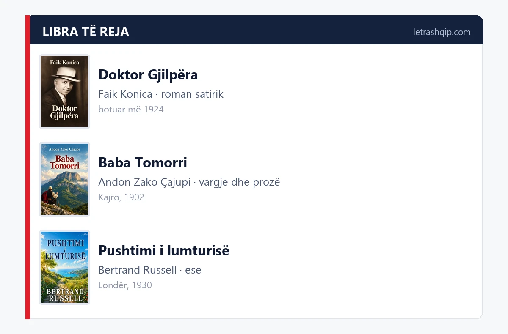
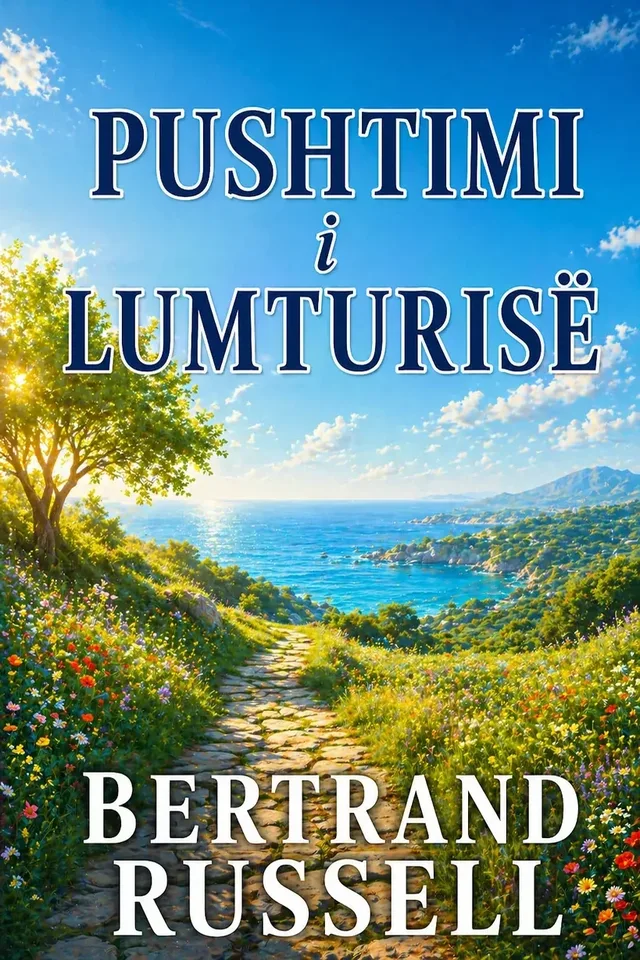

# New Books: three titles added this month

Three books join the LetraShqip catalog this month: a short novel by Faik Konica, a founding book of Albanian verse and a book of essays.

Below are the three titles and a summary for our readers.

## This month

### Doktor Gjilpëra — Faik Konica

**Genre:** satirical novel · **First published:** 1924

A boy raised in Saint Petersburg, where his father had been a merchant, studies medicine in Russia and Sweden and returns to Albania with one simple aim: "to live as a doctor and serve this people". Konica calls him "a rare type in Albania", and states his own purpose openly: "It is very easy to mock, it is harder to understand."

The book is split into three parts — emigration, the return, Tirana. In Durrës it stops at the customs house, where the doctor has to justify his medical tools, and bribery turns into comedy. In Tirana a sick woman is beaten behind a door because the doctor is not allowed to see her, while colleagues argue about quinine and tea. The coffeehouses are judged quickly, yet for the one who observes they are "real schools".

**Why read it:** for the humor that does not lower its voice, for the Albania of the 1920s and for one of Konica's most mature texts.

### Baba Tomorri — Andon Zako Çajupi

**Genre:** poetry, tales and satire · **First published:** Cairo, 1902

A small book that did a great job. Çajupi wrote it abroad and published it in Cairo in 1902, with a purpose he states in the preface: to prove that Albanian is "a language like the others, if not a better one".

Inside there are 30 poems and 24 tales and satires, in three parts: Atdheu (Homeland) opens with the call to the mountain of Tomorri, Dashuria (Love) gathers the laments and the cycle "Dëshirë", Përralla (Tales) laughs at the priests, at the friend with two faces and at the raven who trusts the fox. The book closes with the comedy "Katërmbëdhjetë vjeç dhëndërr!". The line that holds the whole book in memory is from Robëria: "When I see you free — I will love you better."

The spelling is the one of the time, kept as it was first printed. The text comes with a Table of Contents at the start, so you can move easily from a poem to a fable.

**Why read it:** because these verses still make you laugh and still sting, and because in Çajupi you read the Albanian that was defended out loud.

### Pushtimi i lumturisë (The Conquest of Happiness) — Bertrand Russell

**Genre:** essays · **First published:** London, 1930

A book written for ordinary people, not for university chairs. Russell says it in the preface: "This book does not address the learned", and opens with Whitman's lines about animals, which are happy as long as they have health and enough food.

The first part diagnoses: Byronic melancholy, competition (ask a person what stops them from enjoying existence and the answer comes at once: "the battle for life"), boredom, fatigue, the sense of sin and the fear of public opinion. He calls envy "one of the strongest causes of unhappiness". The second part builds: enthusiasm, love, family, work, up to the chapter "The Happy Man", where he says openly that the recipe for happiness is very simple.

**Why read it:** when you want a book that comes straight at you without preaching, in short chapters that can be read one by one.

## How to find these books

All three titles are on letrashqip.com. Search the title in the catalog or open the new books section. Each book page shows the content, the genre and the formats it comes in.

If you prefer listening, check the settings on that book's page. The LetraShqip Reading Club meets every Wednesday at 21:00 on Facebook.

## See you next month

See you next month, when we bring the new titles to read.

---
