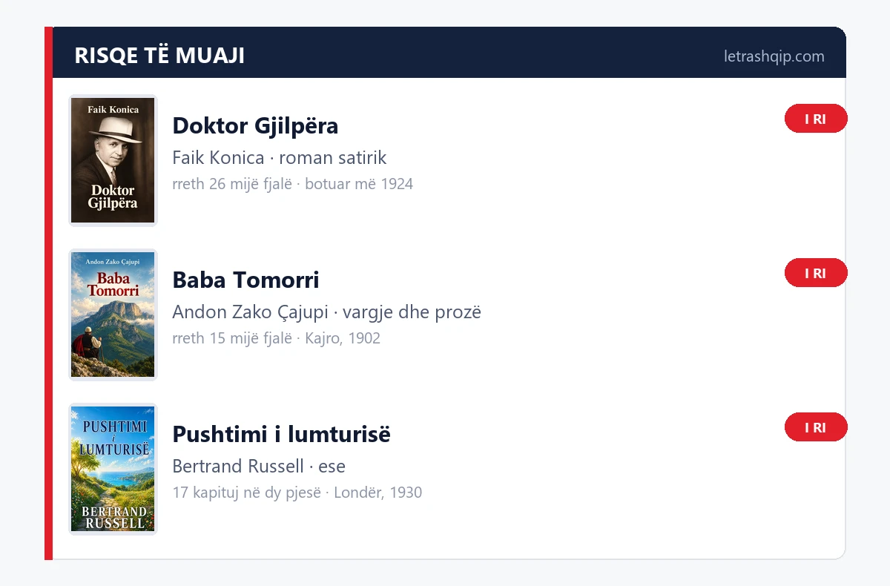

# Librat e Rinj: tre tituj që shtohen këtë muaj

Këtë muaj në katalogun e LetraShqip shtohen tre libra: një roman i shkurtër i Faik Konicës, një gur themeli i vargjeve shqipe dhe një libër ese. 

Më poshtë gjeni tre titujt dhe përmbledhje për lexuesit tanë.

## Këtë muaj

### Doktor Gjilpëra — Faik Konica

**Zhanri:** roman satirik · **Botimi origjinal:** 1924

Një djalë i rritur në Petersburg, ku i ati kishte qenë tregtar, bën mjekësinë në Rusi dhe në Suedi dhe kthehet në Shqipëri me një qëllim të thjeshtë: "të rroj si mjek që t'i shërbej këtij populli". Konica e përshkruan si "një tip i rrallë në Shqipëri", dhe pikësynimin e vet e thotë hapur: "Është shumë lehtë të tallet njeriu, është më e rëndë të kuptojë."

Libri ndahet në tri pjesë — mërgimi, kthimi, Tirana. Në Durrës ndalet te dogana, ku veglat e mjekësisë duhet t'i justifikojë, dhe ryshfeti kthehet në komedi. Në Tiranë një grua e sëmurë rrihet pas derës sepse mjeku nuk lejohet ta shohë, ndërsa kolegët debatojnë për kininën dhe për çajin. Kafetë gjykohen shpejt, por për atë që vëzhgon janë "shkolla të vërteta".

**Pse ta lexosh:** për humorin që nuk e ul zërin, për Shqipërinë e viteve njëzet dhe për një nga shkrimet më të matura të Konicës.

### Baba Tomorri — Andon Zako Çajupi

**Zhanri:** vargje, përralla dhe satirë · **Botimi origjinal:** Kajro, 1902

Një libër i vogël që bëri punë të madhe. Çajupi e shkroi në mërgim dhe e botoi në Kajro më 1902, me një qëllim që e thotë hapur në parathënie: të vërtetojë që Shqipja është "gjuhë si edhe të tjerat, në mos më mirë".

Brenda ka 30 vjersha e 24 përralla dhe satira, të ndara në tri pjesë: Atdheu hapet me thirrjen drejt malit të Tomorrit, Dashuria mbledh vajet dhe ciklin "Dëshirë", Përralla qesh me priftërinjtë, me mikun me dy ftyra dhe me korbin që i beson dhelprës. Librin e mbyll komedia "Katërmbëdhjetë vjeç dhëndërr!". Rreshti që e mban mend gjithë librin është nga Robëria: "Po kur të të sho të-lirë — do të të dua më mirë."

Ortografia është ajo e kohës, e ruajtur ashtu siç u botua. Teksti vjen me Përmbajtje në fillim, që të kaloni lehtë nga vjersha te fabula.

**Pse ta lexosh:** sepse këto vargje ende qesin dhe ende lëndojnë, dhe sepse tek Çajupi lexoni shqipen që u mbrojt me gojë.

### Pushtimi i lumturisë — Bertrand Russell

**Zhanri:** ese · **Botimi origjinal:** Londër, 1930

Libër i shkruar për njerëz të zakonshëm, jo për katedra. Russell e thotë që në parathënie: "Ky libër nuk i drejtohet të mësuarit", dhe hapet me vargjet e Whitman-it për kafshët, që janë të lumtura për aq kohë sa kanë shëndet dhe ushqim të mjaftueshëm.

Pjesa e parë diagnostikon: trishtimi bajronik, konkurrenca (pyet një njeri se çfarë e pengon të shijojë ekzistencën dhe përgjigja vjen menjëherë: "Lufta për jetën"), mërzia, lodhja, ndjenja e mëkatit dhe frika nga opinioni publik. Zilen ai e quan "një nga shkaqet më të fuqishme të moslumturisë". Pjesa e dytë ndërton: entuziazmin, dashurinë, familjen, punën, deri te kapitulli "Njeri i lumtur", ku thotë hapur që receta për lumturinë është shumë e thjeshtë.

**Pse ta lexosh:** kur kërkoni një libër që të vjen për ballë pa predikuar, me kapituj të shkurtër që lexohen një nga një.

## Si t'i gjesh këta libra

Të tre titujt gjenden në letrashqip.com. Kërkoni titullin në katalog ose shikoni rajonin e librave të rinj. Çdo faqe libri tregon përmbajtjen, zhanrin dhe formatet që vijnë me të.

Nëse preferoni të dëgjoni, shikoni cilësimet e faqes për atë titull. Klubi i Leximit i LetraShqip mban takime çdo të mërkurë, ora 21:00, në Facebook.

## Shihemi muajin tjetër

Shihemi muajin tjetër kur të sjellim titujt e rinj për t'u lexuar.

---
