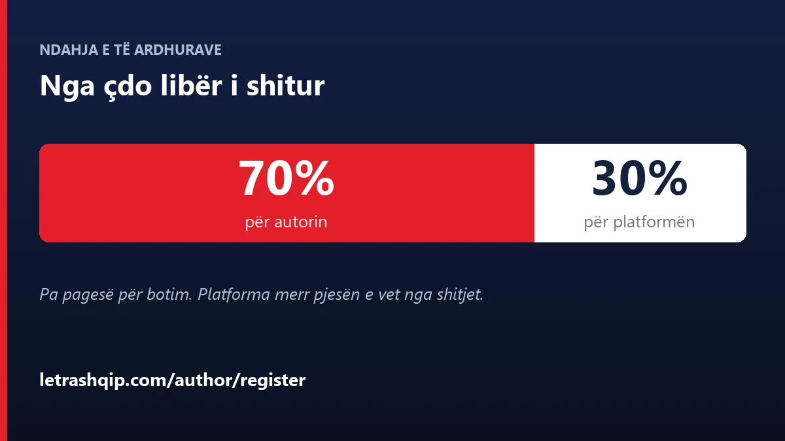
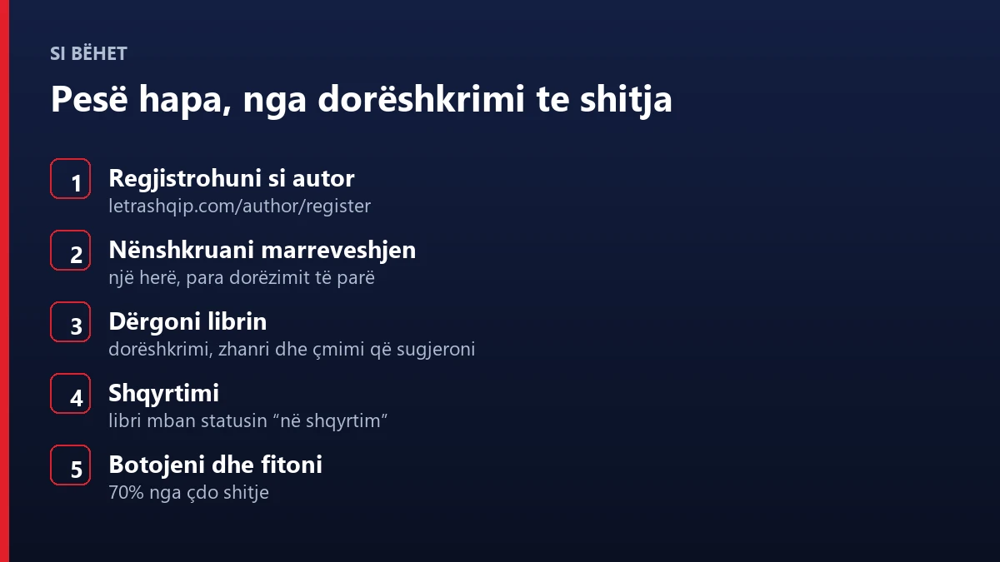

# Shkrimtarë: botojeni librin tuaj dhe merrni 70% nga çdo shitje

A keni një dorëshkrim gati, apo një histori që prej kohësh po prisni ta ndani me botën? LetraShqip pranon dorëshkrime nga shkrimtarë të rinj dhe nga autorë me përvojë, me botim përmes platformës dhe me 70% të të ardhurave nga çdo shitje për autorin.

Pa proces të gjatë botimi, pa pritje mujore dhe pa numër të dytë që e ndjek punën tuaj në heshtje. Libri juaj hidhet në katalog, lexuesit e gjejnë dhe fitimet i shihni vetë, online.

@[youtube](https://youtu.be/iLwj5_8YJ4k)

## Çfarë ju ofrojmë

### 70% e të ardhurave për ju

Nga çdo libër i shitur, pjesa më e madhe është e juaja. Puna dhe talenti juaj meritojnë të shpërblehen siç duhet.

### Botim me disa hapa

Nuk keni nevojë të kaloni nëpër procese të gjata e të komplikuara. Dorëshkrimin e dërgoni nga paneli i autorit, me titull, zhanër dhe çmimin që sugjeroni vetë.

### Publiku juaj ju pret

Librat tuaj janë të disponueshëm për lexuesit që përdorin letrashqip.com dhe aplikacionin për Android, duke përfshirë leximin me zë — një mënyrë e re për t'u lidhur me audiencën, përveç faqeve të shtypura.

### Një faqe publike për autorin

Profili juaj publik mban biografinë, emrin artistik dhe linqet tuaja, pra lexuesi nuk gjen vetëm librin, por edhe autorin.

### Fitime që i shihni vetë

Në panelin e autorit keni totalin e fituar, raportin për libër dhe eksportin e raportit të royaltive, kur ju duhet për dokumente.

## Kush mund të aplikojë

- Shkrimtarë të rinj që botojnë për herë të parë
- Autorë me përvojë që kërkojnë një platformë më fleksibël
- Çdo autor që shkruan në gjuhën shqipe dhe ka një dorëshkrim gati ose në proces
- Autorë që duan që libri i tyre të përkthehet, me hapësirën e punës për përkthime në panel

## Si funksionon procesi

1. **Regjistrohuni** si autor në letrashqip.com/author/register
2. **Nënshkruani marrëveshjen** e autorit, një herë, para dorëzimit të parë
3. **Dërgoni librin** — dorëshkrimi, titulli, zhanri, përshkrimi dhe çmimi që sugjeroni
4. **Shqyrtimi** — ekipi ynë e lexon punën dhe libri mban statusin "në shqyrtim"
5. **Botimi dhe fitimet** — libri hyn në katalog dhe ju merrni 70% nga çdo shitje

Gjatë gjithë kohës librin e ktheni në draft për ta redaktuar dhe e ribotoni kur të jetë gati. Kërkesë për ndryshim çmimi bëhet nga paneli, jo me email.

## Fitimet dhe pagesat

- **Totali i fituar** dhe fitimi për libër, të ndara sipas periudhave
- **Raport i royaltive** që eksportohet kur ju duhet
- **Pagesa elektronike** — lidhni llogarinë tuaj për pagesa automatike ose merrni pagesën me transferim bankar
- **Kërkesë pagese** për mbetjet e konfirmuara, me minimum 25 dollarë

## Çfarë ndryshon nga një botim tradicional

- **Pjesën më të madhe e merrni ju**, jo shtëpia botuese
- **Çmimin ju e sugjeroni** dhe ndryshimin e kërkoni nga paneli
- **Statusin e librit e ndiqni vetë**: draft, në shqyrtim, i botuar
- **Të dhënat tuaja nuk mbeten në një email** — shitjet dhe fitimet i shihni kur të doni

## Pyetje të shpeshta

**A paguaj për të botuar?** Jo. Platforma merr pjesën e vet nga shitjet, nga e ardhuraja e librave të shitur.

**A duhet të jem autor i përvojshëm?** Jo. Pranojmë edhe autorë që botojnë për herë të parë.

**Sa kohë merr shqyrtimi?** Koha varet nga radha dhe nga lloji i dorëshkrimit. Statusin e librit e ndiqni nga paneli.

**A mund ta tërheq librin nga botimi?** Po. Libri kthehet në draft nga paneli, dhe në draft ju e redaktoni dhe e ribotoni.

**A merr libër të përkthyer?** Po. Paneli i autorit mban edhe projektet e përkthimit, të ndara sipas librave. Shikoni [shërbimet tona të përkthimit](https://letrashqip.com/blog/sq/sherbime-perkthimi).

**Si të filloj?** Regjistrohuni në letrashqip.com/author/register, nënshkruani marrëveshjen dhe dërgoni dorëshkrimin tuaj të parë.

## Gati të filloni?

Nëse keni një histori për të treguar, platforma për ta bërë realitet ekziston. [Regjistrohuni si autor](https://letrashqip.com/author/register) dhe bëhuni pjesë e autorëve të LetraShqip.

---
